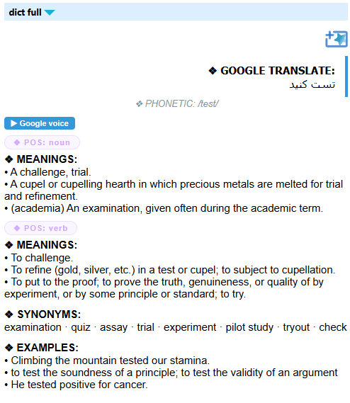
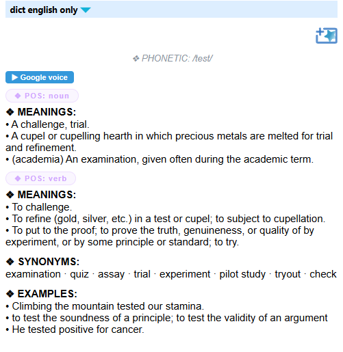
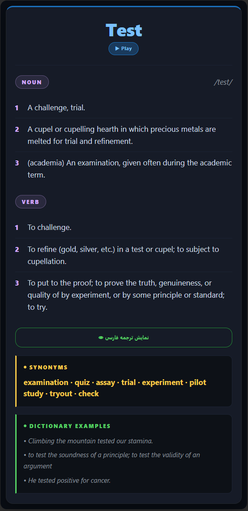
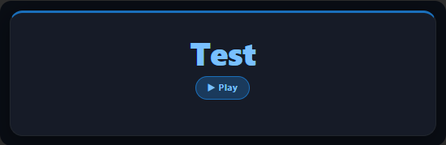

<div dir="rtl" lang="fa">

[English](README.md) | **فارسی**

# goldendict-anki

دو دیکشنری برنامه‌ای برای [GoldenDict-NG](https://xiaoyifang.github.io/goldendict-ng/) که مدخل انگلیسی کلمه را همراه با دکمه‌ی تلفظ نشان می‌دهند، به‌علاوه‌ی یک قالب کارت Anki که همان خروجی را نمایش می‌دهد.

- **`dict_full.py`**: ترجمه‌ی فارسی، مدخل انگلیسی و تلفظ.
- **`dict_eng_only.py`**: فقط مدخل انگلیسی و تلفظ.

## پیش‌نمایش

<table>
  <tr>
    <td valign="top"></td>
    <td valign="top"></td>
  </tr>
  <tr>
    <td align="center"><code>dict_full.py</code></td>
    <td align="center"><code>dict_eng_only.py</code></td>
  </tr>
</table>

<table>
  <tr>
    <td valign="top" align="center"></td>
    <td valign="top" align="center"></td>
  </tr>
  <tr>
    <td align="center">پشت کارت</td>
    <td align="center">روی کارت</td>
  </tr>
</table>

## ویژگی‌ها

- همه‌ی اقسام کلام (تا چهار تا) با تعریف‌های شماره‌دار
- مترادف‌ها، جمله‌های نمونه و تلفظ آوایی
- دکمه‌ی **Google voice** برای شنیدن تلفظ
- در نسخه‌ی کامل، ترجمه‌ی فارسی که روی کارت پشت یک دکمه پنهان است
- برای شبکه‌های ناپایدار ساخته شده: هر بخش از چند سرویس می‌تواند بیاید و سرویس‌های پشتیبان فقط وقتی پرسیده می‌شوند که انتخاب اول جواب ندهد
- هر جست‌وجو حداکثر ۱۵ ثانیه طول می‌کشد
- مسیرهای اتصال مختلف را امتحان می‌کند، از جمله پروکسی محلی برنامه‌ی VPN، پس روشن یا خاموش بودن VPN مهم نیست
- نتیجه‌ی کلمه‌هایی را که جست‌وجو کرده‌اید نگه می‌دارد

## نیازمندی‌ها

- Python نسخه‌ی ۳.۸ یا بالاتر (فقط کتابخانه‌ی استاندارد؛ چیزی با `pip` نصب نمی‌شود). در لینوکس و مک معمولاً دستور `python3` است.
- GoldenDict-NG با پشتیبانی از دیکشنری برنامه‌ای
- Anki، و افزونه‌ی **AwesomeTTS** اگر می‌خواهید تلفظ روی کارت پخش شود

## نصب

```
git clone https://github.com/MohammadMahdiAttai/goldendict-anki.git
```

همه‌ی فایل‌ها باید در یک پوشه بمانند. بررسی کنید که اجرا می‌شود. در ویندوز:

```
python dict_full.py hello
```

در لینوکس و مک:

```
python3 dict_full.py hello
```

باید HTML چاپ شود. در ویندوز از `python.exe` استفاده کنید، نه `pythonw.exe`، چون خروجی استاندارد ندارد و GoldenDict چیزی دریافت نمی‌کند.

## تنظیم GoldenDict-NG

از **Edit → Dictionaries** وارد تب **Sources** و بخش **Programs** شوید و دو دیکشنری برنامه‌ای با نوع `Html` اضافه کنید. مسیر را به محل واقعی فایل‌ها تغییر دهید و هر دو را فعال کنید.

**ویندوز**

| نام                            | نوع    | خط فرمان                                                      |
| ------------------------------ | ------ | ------------------------------------------------------------- |
| Dictionary (Persian + English) | `Html` | `python "C:\Tools\goldendict-anki\dict_full.py" %GDWORD%`     |
| Dictionary (English)           | `Html` | `python "C:\Tools\goldendict-anki\dict_eng_only.py" %GDWORD%` |

**لینوکس و مک**

| نام                            | نوع    | خط فرمان                                                        |
| ------------------------------ | ------ | --------------------------------------------------------------- |
| Dictionary (Persian + English) | `Html` | `python3 "/home/you/goldendict-anki/dict_full.py" %GDWORD%`     |
| Dictionary (English)           | `Html` | `python3 "/home/you/goldendict-anki/dict_eng_only.py" %GDWORD%` |

اسکریپت‌ها و تست‌ها روی ویندوز و لینوکس بررسی شده‌اند. خود GoldenDict-NG فقط روی ویندوز امتحان شده و مک آزمایش نشده است. اگر GoldenDict-NG را به‌صورت Flatpak یا Snap نصب کرده‌اید، ممکن است در محیط ایزوله نتواند `python3` را اجرا کند یا پوشه‌ی اسکریپت را بخواند؛ در این حالت از AppImage یا بسته‌ی توزیع استفاده کنید.

## تنظیم Anki

1. از **Tools → Manage Note Types → Add** یک نوع یادداشت از روی **Add: Basic** بسازید، مثلاً با نام `GoldenDict Word`.
2. در **Fields**، فیلد **Front** را به `Word` و **Back** را به `Meaning` تغییر نام دهید.
3. در **Cards** این سه فایل پوشه‌ی `anki` را بچسبانید:
   - **Front Template**: محتوای `anki/front.html`
   - **Back Template**: محتوای `anki/back.html`
   - **Styling**: محتوای `anki/style.css`
4. افزونه‌ی **AwesomeTTS** را نصب کنید. اگر آن را ندارید، تگ‌های `{{tts ...}}` را از هر دو قالب حذف کنید.
5. خروجی یکی از اسکریپت‌ها را در فیلد `Meaning` بگذارید: اسکریپت را در ترمینال اجرا کنید، HTML چاپ‌شده را کپی کنید و در ویرایشگر HTML فیلد بچسبانید (در ویرایشگر Anki کلید `Ctrl+Shift+X`).

## اگر جست‌وجو شکست خورد یا کند بود

- **خط‌های NOTE بالای مدخل** دلیل را می‌گویند.
- اگر `rate limited (HTTP 429)` دیدید، سرویس درخواست‌های آدرس شما را رد می‌کند. این خطای اسکریپت نیست. چند دقیقه صبر کنید یا سرور VPN دیگری امتحان کنید؛ اسکریپت خودش آن سرویس را مدتی کنار می‌گذارد و از بقیه استفاده می‌کند.
- برای تست همه‌ی سرویس‌ها از همه‌ی مسیرها:

```
python dict_full.py --check
```

- اگر پروکسی VPN شما پیدا نشد، پورت محلی آن را در `dict_core.py` بنویسید:

```python
PROXY = "socks5://127.0.0.1:10808"   # یا "http://127.0.0.1:10809"؛ پورت خودتان را بگذارید
```

- فایل `network.log` در پوشه‌ی کش، جزئیات هر جست‌وجو را نگه می‌دارد. کلمه‌هایی که جست‌وجو کرده‌اید در آن نوشته می‌شود، پس قبل از اشتراک‌گذاری آن را بخوانید.

برای بقیه‌ی جزئیات (تنظیمات، کش، محدودیت‌ها، اجرای تست‌ها) به [README انگلیسی](README.md) نگاه کنید.

## حریم خصوصی

هر کلمه‌ای که جست‌وجو می‌کنید به سرویس‌هایی فرستاده می‌شود که برایش پرسیده می‌شوند: Google و dictionaryapi.dev، و به‌عنوان پشتیبان MyMemory، Wiktionary و Datamuse. با تنظیم `DISABLED_SERVICES` در `dict_core.py` می‌توانید هرکدام را کنار بگذارید. جای دیگری چیزی فرستاده نمی‌شود. اسکریپت فقط `cache.json` و `network.log` را روی کامپیوتر شما می‌نویسد.

## مجوز

پروژه با مجوز MIT منتشر شده است؛ فایل `LICENSE` را ببینید.

</div>
