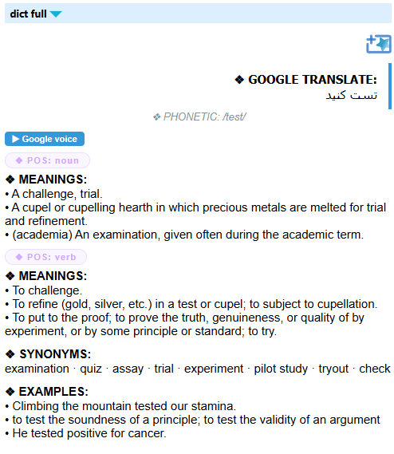
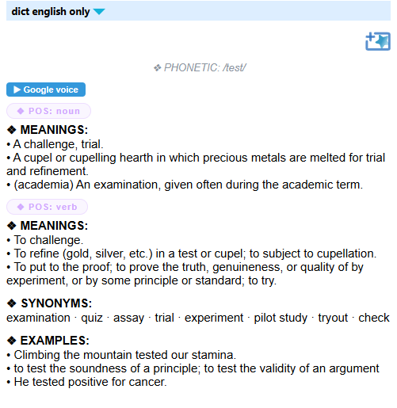
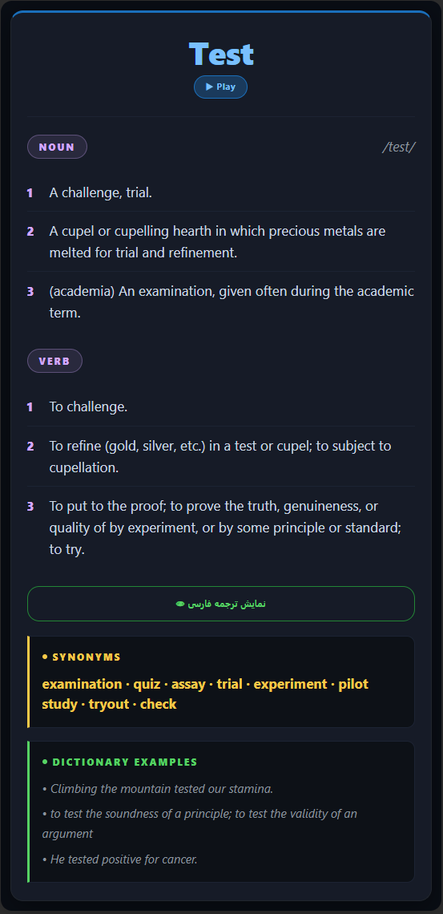

# goldendict-anki

Two program dictionaries for [GoldenDict-NG](https://xiaoyifang.github.io/goldendict-ng/) that show an English entry with a pronunciation button, plus an Anki card design that displays the same output:

- **`dict_full.py`**: Persian translation, English entry and pronunciation.
- **`dict_eng_only.py`**: English entry and pronunciation only.

## Preview

**GoldenDict-NG**

<p>
  
  
</p>

**Anki card** (front and back)

<p>
  
  
</p>
Both print HTML and both work with the same Anki note type.

They are built for unreliable networks and for free services that limit how often they can be used. Each part of the entry can come from several services, and the backup services are only asked when the first choice fails. A lookup always ends within 15 seconds. The scripts try several connection routes, including the local proxy of a VPN app, so it should not matter whether the VPN is on or off. They keep copies of words you have looked up. The card stays clean: a `❖ NOTE` line appears only when a part is really missing. Which service supplied what, and every request, are written to a log file.

For each English word you get:

- every part of speech (up to four), with numbered definitions
- synonyms, example sentences and the phonetic spelling. When the service that supplied the entry lacks one of them, it is filled in from the other services' answers: the phonetic spelling from dictionaryapi.dev or, failing that, Datamuse; examples and synonyms from any other entry that has them
- a **Google voice** button that speaks the word (in the Anki card it is left out; AwesomeTTS speaks the word there)
- in the full version, the Persian translation, hidden behind a button on the card

## Contents

- [Preview](#preview)
- [How it works](#how-it-works)
- [Which service supplies what](#which-service-supplies-what)
- [Files](#files)
- [Requirements](#requirements)
- [Installation](#installation)
- [GoldenDict-NG setup](#goldendict-ng-setup)
- [Anki setup](#anki-setup)
- [On a phone](#on-a-phone)
- [If a lookup fails or is slow](#if-a-lookup-fails-or-is-slow)
- [NOTE lines](#note-lines)
- [Audio](#audio)
- [Command-line options](#command-line-options)
- [Settings](#settings)
- [Cache, saved copies and the log](#cache-saved-copies-and-the-log)
- [Privacy](#privacy)
- [Limitations](#limitations)
- [Running the tests](#running-the-tests)
- [Credits](#credits)

## How it works

GoldenDict-NG runs one of the scripts for each search and passes the word in place of `%GDWORD%`. The script asks the first-choice services at once. If they fail, stay silent, or are known to be unreliable, it asks the backups.

**Rate limits.** Google's free translation endpoint is not an official API and limits how often an address may use it. One report puts the limit at about 100 requests per hour. A VPN address is shared with many people, so it is often already limited, and the server answers `HTTP 429`. Asking again only makes that worse, so the script:

- never repeats a request that was answered with 429 or 403, not over another route that leaves through the same address and not a second time
- leaves that service alone for 10 minutes, doubling each time it happens again up to an hour (a `Retry-After` from the server is respected), and uses the other services meanwhile
- asks Google at most once per word for both programs together (see **One lookup for both programs** below)

**Backups.** Persian translation comes from Google, and from MyMemory when Google fails. The English entry comes from dictionaryapi.dev, then Google, then Wiktionary, then Datamuse. A backup is asked after 2 seconds of silence from the first choice, or at once when the first choice failed or did not answer in recent lookups. A lesser answer is shown only when the better services fail, and the card says which service supplied it. A better service that is still running gets 4 seconds in all (2 seconds if it was only asked for an extra: the phonetic spelling, examples or synonyms), counted from when it was asked, and at least half a second after the lesser answer arrived.

**Completing the entry.** The best entry that arrives is the base, and its gaps are filled from the other services: the phonetic spelling from dictionaryapi.dev or Datamuse (in IPA), examples from dictionaryapi.dev, Google or Wiktionary, and synonyms from dictionaryapi.dev or Google. A service is waited for an extra only briefly, and not at all if it is known to be down. The log says where each part came from, and `SHOW_SOURCE_NOTES` can show it on the card too (see [NOTE lines](#note-lines)).

**One lookup for both programs.** GoldenDict-NG starts both programs for a search at the same moment. Left alone, each would ask the services itself and decide by its own timing when it has enough, so the two cards could differ (one with examples, one without, for instance) and Google would be asked twice. Instead, the first program to start takes a short lock for that word and does the lookup. The other waits (at most 8 seconds), then reads what the first one saved. Both are built from the same answers, so the English part is the same in both, and the services are asked once. Both programs ask the same services for the entry, Google included. The lock is a small file, `lookup-<hash>.lock`, in the cache folder. It is removed when the lookup ends, and one left behind by a script that died is ignored after 20 seconds.

**Capital letters.** A word whose only capital is its first letter (`Dispatched`) is usually at the start of a sentence, so its lower-case form is looked up first, and the form as typed second. Anything else with capitals (`NASA`, `iPhone`, `New York`) is looked up as typed first. Datamuse's answer uses one entry only, so the common sense of a word is not mixed with a proper noun of the same spelling.

**Time budget.** The script prints what it has within 15 seconds, however the network behaves. The process ends at that point even if a request is still hanging.

**Connection routes.** Each request can use several routes. They start one after another, 1.2 seconds apart, and the first answer wins, so a route that hangs never holds up one that works. A route that fails at once lets the next one start at once.

1. the route that worked last time for that service
2. a direct connection
3. the proxy from `PROXY`, or else the system proxy
4. a **local proxy found automatically**: the script checks a short list of ports that VPN apps commonly use on `127.0.0.1` and recognises HTTP and SOCKS5 proxies (this covers VPN apps that run in proxy mode without setting the system proxy)
5. a direct connection over IPv4 only (some networks never answer IPv6)

Through a proxy, the proxy resolves the server name, so a blocked or poisoned local DNS does not matter. When a VPN is off, nothing listens on those ports and the direct route is used.

**Saved copies.** Results are kept on disk. A result is fresh for 30 days (one day for a backup service's result, so a better service can take over) and then needs no network at all. When the network fails, a saved copy of up to a year old is used instead.

## Which service supplies what

| Service                                         | Supplies                                                       | Asked                                                                                | Notes                                                                                                                                             |
| ----------------------------------------------- | -------------------------------------------------------------- | ------------------------------------------------------------------------------------ | ------------------------------------------------------------------------------------------------------------------------------------------------- |
| Google (`translate.googleapis.com`)             | Persian translation; English definitions, examples, synonyms   | first, in both versions (one request brings the translation and the dictionary data) | free, unofficial, limited per address                                                                                                             |
| [dictionaryapi.dev](https://dictionaryapi.dev/) | English entry with phonetics                                   | first                                                                                | free, sometimes slow or down (its own server can answer with Cloudflare error 522)                                                                |
| [MyMemory](https://mymemory.translated.net/)    | Persian translation                                            | backup for Google                                                                    | the free quota is small (about 5000 characters per day without an e-mail address)                                                                 |
| [Wiktionary](https://en.wiktionary.org/)        | English definitions and examples                               | backup                                                                               | no phonetic spelling                                                                                                                              |
| [Datamuse](https://www.datamuse.com/api/)       | English definitions (WordNet) and the phonetic spelling in IPA | backup, and for a missing phonetic spelling                                          | definitions are terse and have no examples; the phonetic spelling is American English and exists only for words in the CMU Pronouncing Dictionary |

## Files

```
goldendict-anki/
├── dict_full.py        GoldenDict program: Persian + English + audio
├── dict_eng_only.py    GoldenDict program: English + audio
├── dict_core.py        shared code (both programs import it; keep it in the same folder)
├── dict_lookup.py      same as dict_full.py, kept so an existing GoldenDict entry keeps working
├── anki/
│   ├── front.html      card front
│   ├── back.html       card back (builds the layout from the Meaning field)
│   └── style.css       styling for the note type
├── tools/
│└── make_preview.py  builds preview.html: the card at phone and computer widths (not committed)
|   ├── docs/
|   │   └── images/         screenshots used in this README
├── tests/
│   ├── test_dict_core.py
│   └── run_back_template.js  test helper: runs the card's script with Node, to check the layout it builds
├── .gitignore
└── README.md
```

## Requirements

- Python 3.8 or newer. The scripts use only the standard library, so there is nothing to install with `pip`.
- GoldenDict-NG, with program dictionaries.
- Anki, with the **AwesomeTTS** add-on if you want the word spoken on the card.

## Installation

Clone the repository or download it, and keep all the files in the same folder:

```
git clone https://github.com/MohammadMahdiAttai/goldendict-anki.git
```

Check that the full version runs:

```
python dict_full.py hello
```

You should see HTML printed. On Windows, use `python.exe`, not `pythonw.exe`: it has no standard output, so GoldenDict would receive nothing.

## GoldenDict-NG setup

Add two program dictionaries. In GoldenDict-NG, open **Edit → Dictionaries**, go to the **Sources** tab and then the **Programs** section. (If your version labels these differently, look for the program dictionary settings there.) For each program, set:

| Name                           | Type   | Command line                                                  |
| ------------------------------ | ------ | ------------------------------------------------------------- |
| Dictionary (Persian + English) | `Html` | `python "C:\Tools\goldendict-anki\dict_full.py" %GDWORD%`     |
| Dictionary (English)           | `Html` | `python "C:\Tools\goldendict-anki\dict_eng_only.py" %GDWORD%` |

Change the path to wherever you saved the files, and enable both programs.

If you already have a program that runs `dict_lookup.py`, it keeps working. You can point it to `dict_full.py` instead.

GoldenDict replaces `%GDWORD%` with the word you searched for. Phrases such as `ice cream` work because the scripts join their arguments back together.

## Anki setup

1. Create a note type with **Tools → Manage Note Types → Add**, choose **Add: Basic**, and give it a name such as `GoldenDict Word`.
2. Click **Fields**. Rename **Front** to `Word` and **Back** to `Meaning`.
3. Click **Cards** and paste the three files from the `anki` folder:
   - **Front Template:** the contents of `anki/front.html`
   - **Back Template:** the contents of `anki/back.html`
   - **Styling:** the contents of `anki/style.css`
4. Install the **AwesomeTTS** add-on (**Tools → Add-ons → Get Add-ons**). The templates use `{{tts en_US voices=AwesomeTTS:Word}}` to speak the word. If you do not use AwesomeTTS, delete those `{{tts ...}}` tags from both templates.
5. Fill the `Meaning` field with the output of either script. The simplest way is to run the script in a terminal, for example `python dict_full.py hello`, copy the printed HTML, and paste it into the field's HTML editor (press Ctrl+Shift+X in Anki's editor), so the markup is kept as printed.

Both versions use the same note type. Notes made with the older scripts still display correctly.

**How the card is laid out.** The back template reads the `Meaning` field as text and builds the layout from it:

- the word and its play button on top, then one row per part of speech, with the **phonetic spelling on the right of the first row**
- the numbered meanings of each part of speech, then a button that shows the Persian translation, then the synonyms and the examples
- problem notes (`❖ NOTE` lines) in an amber box at the top
- what is not text is dropped: players, links and the text that play buttons leave behind (for example `▶ Google voice`)
- repeated lines, parts of speech and synonyms are shown once, and meanings that come without a part of speech are kept
- all text is escaped before it is put into the page, and if the script fails for any reason the field is shown as plain text, so the card is never empty

GoldenDict-NG also has its own Anki integration (through the AnkiConnect add-on). It sends the entry's HTML, which may include extra text from the dictionary's header. Check the card after the first export.

## On a phone

The card adapts to the width of the screen. On a phone it has larger text and less space around the card, long words wrap instead of being cut off, and the buttons are bigger. All the sizes are variables at the top of `.my-wrap` in `anki/style.css`. Change `--fs-body`, `--fs-small` and the others there if you want the text larger or smaller.

**Which app.** Use the apps of the Anki project: **AnkiDroid** on Android, **AnkiMobile** on iPhone and iPad (paid), or **AnkiWeb** in a mobile browser. They run the same note type (HTML, CSS and JavaScript) as the computer. Apps that merely have "Anki" in their name are not part of the Anki project, so there is no reason to expect them to run this note type. Changing the app would not fix a layout problem anyway: the card's own styling does.

**Updating the phone.** The styling belongs to the note type. After pasting the new `anki/style.css` into **Tools → Manage Note Types → Cards → Styling** on the computer, sync there, and then sync on the phone.

**Checking the layout without a phone.** Run

```
python tools/make_preview.py
```

and open the `preview.html` it writes in a browser. It shows four sample cards (a normal entry, a long word, a word that has only a translation, and a problem note), each as the front and the back, in frames of 360, 412 and 820 pixels. Each frame has the width of a screen, so the phone rules apply as they do on a device. It is the browser's engine, not AnkiDroid or AnkiMobile, which can differ a little: both have their own margins and text-size settings, and AnkiDroid has display settings of its own that scale cards. If a card still looks wrong on your phone, a screenshot shows what to change.

**Sound.** The card uses Anki's text-to-speech tag, `{{tts en_US voices=AwesomeTTS:Word}}`. AwesomeTTS is an add-on for the computer, so on a phone the card relies on the phone's own text-to-speech voices. According to the Anki manual, AnkiDroid supports these tags from version 2.17 and AnkiMobile from 2.0.56, and `voices=` lists the voices to prefer. I have not checked how AnkiDroid treats the preference when AwesomeTTS is missing. If the play button does nothing on the phone, change the tag to `{{tts en_US:Word}}` in both templates. That does not name a voice, but it also stops the computer from preferring AwesomeTTS's voice. The Google voice button of GoldenDict is not part of the card: the template removes it.

## If a lookup fails or is slow

Work through these steps in order. Each one narrows down the cause.

**1. Look at the NOTE lines at the top of the entry.** They appear only when a part is missing, and say why. The last line gives the path of the log file. To see where each part came from even when nothing is missing, read `network.log` or set `SHOW_SOURCE_NOTES = True` in `dict_core.py`.

**2. If a NOTE says `rate limited (HTTP 429)`,** the service is refusing requests from your address. It is not a fault of the script. Waiting helps, and so does another VPN server, because a different address has its own limit. The script leaves a service that answered 429 alone for 10 minutes or longer, and the other services fill in meanwhile. You do not need to do anything.

**3. Test the services in a browser, with the VPN on.** Open the addresses:

```
https://translate.googleapis.com/translate_a/single?client=gtx&sl=en&tl=fa&dt=t&q=hello
https://api.dictionaryapi.dev/api/v2/entries/en/hello
https://api.mymemory.translated.net/get?q=hello&langpair=en|fa
https://api.datamuse.com/words?sp=hello&md=dr&ipa=1&max=1
https://en.wiktionary.org/api/rest_v1/page/definition/hello
```

If a page loads in the browser but the script cannot reach it, Python is not going through your VPN. Steps 4 and 5 fix that. If a page does not load in the browser either, the service itself is unreachable or down. The script cannot fix that, but the other services and saved copies still work.

**4. Run the connection check.**

```
python dict_full.py --check
```

It tests each service over each route at the same time and prints the result and the time:

```
python 3.12.3 on Windows
PROXY setting: none
system proxy: none
local proxy ports found: socks5://127.0.0.1:10808

service             route                         result                        time
dictionaryapi.dev   direct                        timeout                       8.0s
dictionaryapi.dev   socks5://127.0.0.1:10808      ok                            1.1s
Google              direct                        rate limited (HTTP 429)       0.4s
Google              socks5://127.0.0.1:10808      ok                            0.9s
...
summary:
  dictionaryapi.dev   reachable via socks5://127.0.0.1:10808
  Google              reachable via socks5://127.0.0.1:10808
  MyMemory            reachable via direct, socks5://127.0.0.1:10808
```

(This is an example of the format, not real output.) Run it once with the VPN on and once with it off. Each run sends a few requests to every service, so do not repeat it many times in a row. `answered, but no usable data` means the service replied but the reply had nothing the script can use, which is different from being unreachable. `ok, but no definitions` for Google means the translation worked but the English definitions were missing from the reply, and `ok, but no phonetic spelling` for Datamuse means it answered without the IPA pronunciation.

**5. Name your VPN's proxy, if it was not found.** If `local proxy ports found` says `none` while the VPN is on, open the VPN app's settings, find its local HTTP or SOCKS port, and set it in `dict_core.py`:

```python
PROXY = "socks5://127.0.0.1:10808"   # or "http://127.0.0.1:10809"; use your own port
```

**6. If a card has no phonetic spelling,** dictionaryapi.dev did not answer (its server sometimes returns Cloudflare error 522, even in a browser) and Datamuse does not know the word. Datamuse's pronunciations come from the CMU Pronouncing Dictionary, so names, new words and some inflected forms are missing. The Google voice button still works.

**7. Read the log.** `network.log` keeps the last 20 lookups with every route's result and time. It is in the same folder as the cache file (see below). The words you looked up are written to it, so look before you share it.

## NOTE lines

By default the card has `❖ NOTE` lines only for problems:

- `Persian translation unavailable (Google: rate limited (HTTP 429); MyMemory: timeout).`: no service supplied it.
- `English entry not available (dictionaryapi.dev: timeout; Google: connection failed; Wiktionary: no entry; Datamuse: no entry).`: no service supplied it, and the failures mean the word may well have an entry. `no entry` means the service answered and does not know the word.
- `English entries are only looked up for one or two words.`: the English-only version got a longer phrase.
- `Network details: <path>`: where the log with the details is. It follows a missing part.

A word, name or phrase that has no entry at all is not a problem, and nothing is written for it. The script concludes this when two services answered that they have nothing and one of them is a broad one (Wiktionary or dictionaryapi.dev); Google and Datamuse alone are not enough, because they only know common words. The card then has just the translation, and the English-only version shows nothing, as any dictionary does for a word it does not have. It does not matter that another service was down at the time. The script stops waiting for the services that have not answered, and a later lookup of the same word needs no network, because the "no entry" answers are saved for a day. The log says `No English entry found (...)`.

Nothing is written when every part is there, even if a backup service supplied it. That information is in `network.log`, one `note:` line per lookup. To see it on the card as well, set `SHOW_SOURCE_NOTES = True`. The card then also says, for example:

- `Persian translation from MyMemory (Google: rate limited (HTTP 429)).`: the translation came from a backup because the better service failed. The reason is given in the brackets.
- `English entry from Wiktionary (dictionaryapi.dev: no answer in time; Google: rate limited (HTTP 429)).`: the entry came from a backup.
- `English entry from Wiktionary (...), with the phonetic spelling from Datamuse.` or `English entry from Google, with the phonetic spelling from Datamuse.`: the phonetic spelling was added from another service.
- `Some results are saved copies from 2026-09-12, because the network did not answer.`: the result is a copy saved earlier. Nothing is wrong with the entry itself.

The reasons are `timeout` (no route answered in time), `no answer within 15 s` or `no answer in time` (the script stopped waiting), `rate limited (HTTP 429)`, `refused (HTTP 403)`, `skipped, it limited the requests recently` (the service is in its waiting period), `connection failed` (the address could not be reached at all), `TLS error` (the secure connection was refused, for example by a proxy that intercepts traffic), `server error (HTTP 5xx)` (the service's own server failed, for example Cloudflare's 522 or 530 in front of dictionaryapi.dev), `HTTP <code>` (another refusal or error) and `unexpected response` (the reply was not in the expected form).

## Audio

Every English entry has one button, **Google voice**, which speaks the word with Google's text-to-speech service. It is the same button the original scripts had. In the Anki card it is left out, because AwesomeTTS speaks the word there.

There used to be a second button, **Recording**, that played dictionaryapi.dev's recorded pronunciation. It appeared only for words that service had answered, and it came from the same server that is often down, so it was removed. To bring it back, set `RECORDING_BUTTON = True` in `dict_core.py`.

The audio is fetched by GoldenDict-NG itself when you press a button, not by the script. It therefore follows GoldenDict-NG's own network settings (look for proxy options in its preferences), not the routes described above, and Google voice is subject to Google's limits. Both the voice and the recording are MP3 files, and some builds of Qt WebEngine, the engine GoldenDict-NG shows its articles in, cannot play MP3 in an HTML audio tag. If a button does nothing while the entry itself loads fine, that is the likely cause or the network settings above. I could not check GoldenDict-NG's own build.

## Command-line options

| Option           | Effect                                                              |
| ---------------- | ------------------------------------------------------------------- |
| `--check`        | Test every service over every route and print the results.          |
| `--no-translate` | Skip the Persian translation. `dict_eng_only.py` already does this. |
| `--no-define`    | Skip the English entry.                                             |
| `--no-cache`     | Neither read nor write the cache.                                   |
| `--debug`        | Write requests and errors to stderr.                                |

Options must come before the word. `--` ends the options, so a word that begins with `--` can still be looked up.

## Settings

These constants are at the top of `dict_core.py`:

| Setting              | Default      | Meaning                                                                                        |
| -------------------- | ------------ | ---------------------------------------------------------------------------------------------- |
| `PROXY`              | `""`         | Your VPN's proxy, for example `socks5://127.0.0.1:10808` or `http://127.0.0.1:10809`.          |
| `AUTO_PROXY`         | `True`       | Look for a VPN app's local proxy on `127.0.0.1`.                                               |
| `LOCAL_PROXY_PORTS`  | common ports | The ports probed by `AUTO_PROXY`. Only `127.0.0.1` is ever probed.                             |
| `ENABLE_AUDIO`       | `True`       | The Google voice button.                                                                       |
| `RECORDING_BUTTON`   | `False`      | Also a Recording button with dictionaryapi.dev's MP3, when it has one.                         |
| `SHOW_SOURCE_NOTES`  | `False`      | Also write the notes that say which service supplied a part. They are always in `network.log`. |
| `DISABLED_SERVICES`  | `()`         | Services never used, for example `("mymemory", "datamuse")`. See [Privacy](#privacy).          |
| `MYMEMORY_EMAIL`     | `""`         | An e-mail address, which raises MyMemory's daily limit. See its documentation.                 |
| `TOTAL_BUDGET`       | `15.0`       | Seconds after which the script prints what it has.                                             |
| `HEDGE_DELAY`        | `2.0`        | Seconds of silence from a first choice before a backup is asked.                               |
| `OPTIONAL_GRACE`     | `4.0`        | Seconds in all that a better service gets once a lesser answer is in hand.                     |
| `EXTRA_GRACE`        | `2.0`        | The same, for a service asked only to add an extra (phonetic spelling, examples, synonyms).    |
| `SHORT_GRACE`        | `0.5`        | The same, for a service that did not answer in recent lookups.                                 |
| `LOOKUP_WAIT`        | `8.0`        | Seconds the second program waits for the first one's lookup of the same word.                  |
| `COOLDOWN_BASE`      | `600`        | Seconds a service that answered 429 or 403 is left alone. Doubles on each repeat.              |
| `COOLDOWN_MAX`       | `3600`       | The longest such wait (a longer `Retry-After` from the server is respected).                   |
| `ROUTE_TIMEOUT`      | `8.0`        | Seconds one network operation on a route may take.                                             |
| `ROUTE_STAGGER`      | `1.2`        | Seconds before the next route starts alongside the earlier ones.                               |
| `CACHE_TTL`          | 30 days      | How long a result is fresh (no network needed).                                                |
| `BACKUP_TTL`         | 1 day        | The same for a backup service's result.                                                        |
| `NEGATIVE_CACHE_TTL` | 1 day        | How long a "not found" answer is fresh.                                                        |
| `STALE_TTL`          | 1 year       | How old a saved copy may be and still be used when the network fails.                          |

## Cache, saved copies and the log

Successful results are kept on disk. Fresh results are used without any network request. Older results are used only when the network fails. Failures are never saved. "Not found" answers are fresh for one day and are never used as saved copies.

The same file remembers which route worked for each service, which service was not answering in the last ten minutes, and which one limited the requests and until when. That is how a slow or limiting service stops delaying and burdening every lookup.

GoldenDict-NG runs both programs for every search, at the same moment. Saving therefore never overwrites the file: each script re-reads it, adds only what it learned and writes the result in one step, under a short lock (a lock left behind by a script that died is ignored after 10 seconds). Without this, the second program to finish would erase the first one's results and its `rate limited` marks.

The files are in:

- Windows: `%LOCALAPPDATA%\goldendict-anki\` (`cache.json` and `network.log`)
- Linux and macOS: `$XDG_CACHE_HOME/goldendict-anki/`, or `~/.cache/goldendict-anki/` if `XDG_CACHE_HOME` is not set

Besides `cache.json` and `network.log`, the folder briefly holds small `.lock` files while a lookup or a save is running. Delete `cache.json` to clear the cache and the network memory, including a waiting period after a 429. Cached results are stored in parsed form, so after you change how results are parsed, run with `--no-cache` or delete the file.

## Privacy

Every word you look up is sent to the services that are asked for it: Google, dictionaryapi.dev, and, as backups, MyMemory, Wiktionary and Datamuse. Use `DISABLED_SERVICES` to leave out any of them. Nothing is sent anywhere else. The only things the script writes on your computer are `cache.json` and `network.log` in the folder named above, and the log contains the words you looked up (the last 20). The proxy probing talks only to `127.0.0.1`.

## Limitations

- A word you have never looked up needs a working route to at least one service. A saved copy can only answer for words that were saved before.
- The script cannot make an unreachable or rate-limiting service available. It tries every route and backup it knows, and `--check` shows what it found.
- Backup entries are plainer: Wiktionary has no phonetic spelling, and Datamuse's definitions are terse and have no examples. A phonetic spelling from Datamuse is American English and can differ from dictionaryapi.dev's. MyMemory's translations come from a shared translation memory and can be less accurate than Google's for single words.
- The Google voice button plays audio from the internet when you press it, through GoldenDict-NG's own network settings and web engine. Saved copies do not include the audio.
- The two programs share one lookup per word, but if the first is still busy after 8 seconds the second goes ahead on its own, and the two can then differ. The programs also differ in one respect by design: only the full one shows the translation.
- The Google endpoint is not an official API. It can change or stop working without notice, and the English definitions read from it depend on its response layout. The Wiktionary endpoint is a public Wikimedia one that can also change.
- Only HTTP and SOCKS5 proxies without a login are supported. A proxy that needs a user name and password is not.
- Definitions are looked up only for one- and two-word queries.
- GoldenDict-NG may have its own time limit for program dictionaries. The script keeps within 15 seconds, and `TOTAL_BUDGET` can be lowered if that is too long for your setup.

## Running the tests

From the project folder:

```
python -m unittest discover -s tests -v
```

The tests need no internet access. The tests of the card's script run the real back template with Node and are skipped if Node is not installed. Services are replaced with fakes, and the connection routes are tested against small servers and proxies on your own computer: a service that never answers, an HTTP proxy and a SOCKS5 proxy that stand in for a VPN app, automatic proxy detection, remembered routes, a server that answers 429, a server that fails once, an untrusted certificate, an HTTPS server reached over IPv4 only, a process that must exit on time while its requests are still hanging, and the two programs started as two real processes at the same moment, which must ask each service once and show the same English entry. The parsers are tested against samples that follow the services' documented response formats, not against the live services. The `openssl` command is needed for the tests that use HTTPS; those tests are skipped without it.

## Credits

- Persian translation and English definitions: Google Translate's public web endpoint
- English entries with phonetics: [dictionaryapi.dev](https://dictionaryapi.dev/)
- Backup translation: [MyMemory](https://mymemory.translated.net/)
- Backup definitions: [Wiktionary](https://en.wiktionary.org/) (its text is available under the CC BY-SA licence) and the [Datamuse API](https://www.datamuse.com/api/) (also for IPA pronunciations; free for non-commercial use; please credit it if you build on this)
- Google voice: Google Translate text-to-speech
- Anki card audio: the AwesomeTTS add-on
- GoldenDict-NG, the program that runs the scripts: [xiaoyifang/goldendict-ng](https://github.com/xiaoyifang/goldendict-ng)
